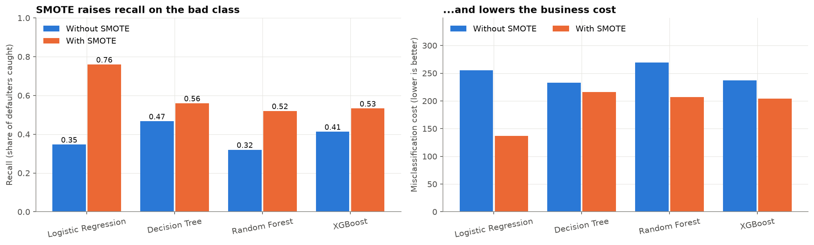
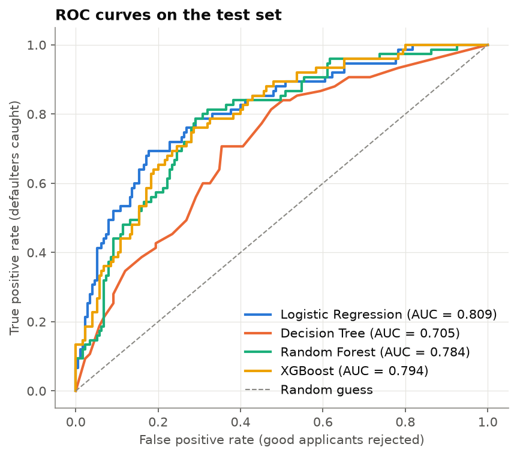
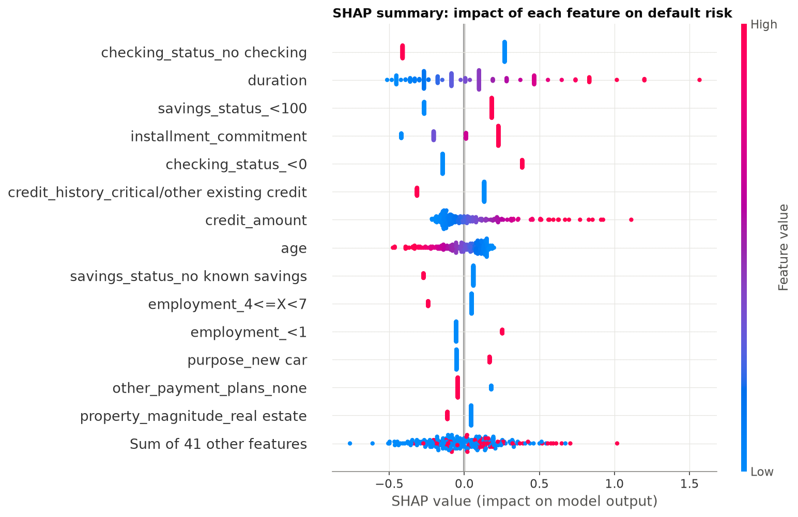
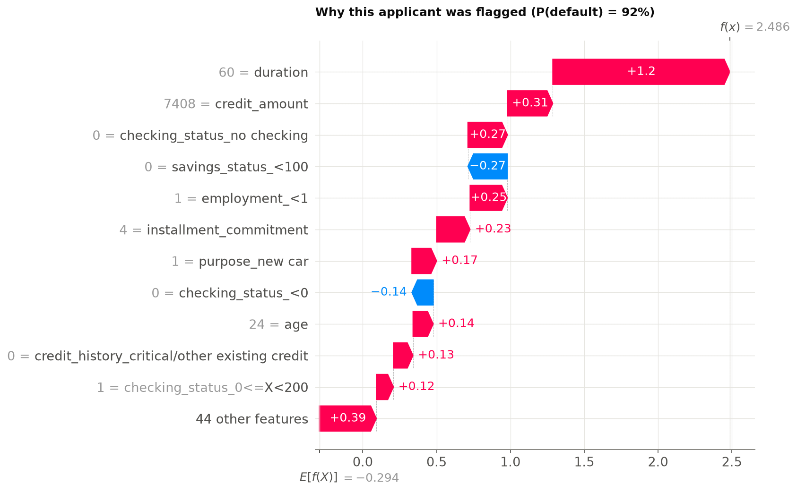

# Credit Risk Modeling (SMOTE + SHAP)

[](https://colab.research.google.com/github/sayleeraut/credit-risk-modeling/blob/main/credit_risk_modeling.ipynb)

This project predicts which loan applicants are likely to **default**, using the real German Credit dataset. It handles the **class imbalance with SMOTE**, applied to the training data only. It compares **Logistic Regression, a Decision Tree, Random Forest and XGBoost**, focusing on **recall and ROC-AUC**, and explains the decisions with **SHAP**, including a breakdown for one individual applicant.

## Goal

- Show the class imbalance (70% good and 30% bad applicants) and fix it with **SMOTE on the training data only**.
- Train and tune Logistic Regression, a Decision Tree and ensemble models (Random Forest, XGBoost).
- Evaluate with a focus on **recall** (catching defaulters), **ROC-AUC**, and the dataset's **5:1 misclassification cost**.
- Explain the model with a **SHAP summary plot, global feature importance, and an individual applicant explanation**.

## Dataset

**Statlog (German Credit Data)**: 1,000 real loan applicants from a German bank, with 20 attributes and a good/bad risk label.

- Source: [UCI Machine Learning Repository, Statlog German Credit](https://archive.ics.uci.edu/dataset/144/statlog+german+credit+data) (Prof. Hans Hofmann, University of Hamburg)
- Loaded with `sklearn.datasets.fetch_openml("credit-g")` from [OpenML dataset 31](https://www.openml.org/d/31) (the same data with readable labels). No manual download is needed.
- Cost matrix from the dataset documentation: approving a bad applicant costs **5**, and rejecting a good applicant costs **1**.

## Tools

Python 3.12, pandas, NumPy, Matplotlib, Seaborn, scikit-learn, imbalanced-learn (SMOTE), XGBoost, SHAP, Jupyter

## Approach

1. **Cleaning and ethics.** The data has no missing values or duplicates. I **dropped `personal_status` (sex) and `foreign_worker` (national origin)**, because lending laws prohibit credit decisions based on these attributes.
2. **EDA.** Looked at the class imbalance, default rates by checking account, credit history, purpose and age, the duration and amount distributions, and a correlation heatmap.
3. **Split.** 75/25 stratified train/test split. The test set (250 applicants, 75 defaulters) is never resampled.
4. **SMOTE (training data only).** The training set goes from 525 good / 225 bad to 525 / 525. SMOTE runs inside an `imblearn` Pipeline, so during cross-validation it only touches the training folds. A cross-validation experiment showed that **SMOTE after one-hot encoding** works better here than **SMOTENC**.
5. **Models.** Logistic Regression, Decision Tree, Random Forest and XGBoost, tuned with a 5-fold grid search on ROC-AUC. Each was also refit **without SMOTE** for comparison.
6. **Explainability.** SHAP `LinearExplainer` for the best model (beeswarm, mean |SHAP| bar chart, waterfall for one applicant), plus a `TreeExplainer` on XGBoost as a cross-check.

## Results (test set, 250 applicants)

| Model (with SMOTE) | Accuracy | Precision | **Recall** | F1 | **ROC-AUC** | Cost (5·FN+FP) |
|---|---|---|---|---|---|---|
| **Logistic Regression** | 0.740 | 0.548 | **0.760** | **0.637** | **0.809** | **137** |
| Decision Tree | 0.664 | 0.452 | 0.560 | 0.500 | 0.705 | 216 |
| Random Forest | 0.748 | 0.591 | 0.520 | 0.553 | 0.784 | 207 |
| XGBoost | 0.744 | 0.580 | 0.533 | 0.556 | 0.794 | 204 |

**Effect of SMOTE on recall:** Logistic Regression 0.35 → **0.76**, Decision Tree 0.47 → 0.56, Random Forest 0.32 → 0.52, XGBoost 0.41 → 0.53. The misclassification cost fell for every model, and for Logistic Regression from 255 to 137.

**Best model: Logistic Regression with SMOTE.** It catches **57 of the 75 defaulters** (recall 0.76), has the best ROC-AUC (0.809), and is the easiest model to explain.



| ROC curves | SHAP summary |
|---|---|
|  |  |

**SHAP explanation of one applicant.** A 60-month, 7,408 DM loan for a 24-year-old who had been employed for less than a year. The model predicted a 92% default probability, and the applicant did default:



## Key insights

- **Checking account status is the strongest signal.** Overdrawn accounts default 49% of the time, while applicants with no checking account at this bank default only 12%.
- **Long loans are risky.** Loans over 24 months default 44% of the time, against 26% for shorter loans. In the example above, duration alone adds +1.2 log-odds of default.
- **Low savings, a high instalment burden and young age (19-25: 42% default)** raise risk. A proven credit history lowers it.
- **SMOTE matters more than model choice.** Without rebalancing, every model missed most defaulters.
- **The explanations are consistent.** Logistic Regression and XGBoost rank the features very similarly (Spearman 0.83), which suggests these are real risk drivers.
- **Recommendation:** use the model for screening and manual review rather than automatic rejection. Offer flagged applicants shorter terms, smaller amounts or a guarantor, and monitor approval rates across groups for fairness.

## How to run

**In Google Colab:** click the badge above, then choose **Runtime → Run all**. The first cell installs `imbalanced-learn`, `xgboost` and `shap` if needed, and the data is fetched from OpenML.

**Locally:**

```bash
git clone https://github.com/sayleeraut/credit-risk-modeling.git
cd credit-risk-modeling
python -m venv venv
# Windows: venv\Scripts\activate   |   macOS/Linux: source venv/bin/activate
pip install -r requirements.txt
jupyter notebook credit_risk_modeling.ipynb
```

To re-run everything from the command line:

```bash
jupyter nbconvert --to notebook --execute --inplace credit_risk_modeling.ipynb
```

The full run takes about 1-2 minutes. Seeds are fixed (`SEED = 42`), so the results are reproducible.

## Project structure

```
credit-risk-modeling/
├── credit_risk_modeling.ipynb   # main notebook (executed, with outputs)
├── images/                      # charts saved by the notebook + results_table.csv
├── requirements.txt
└── README.md
```
